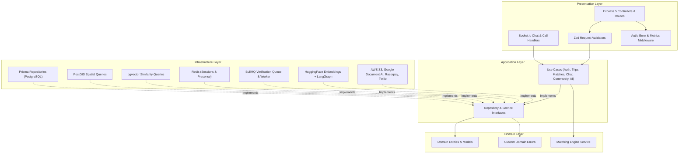
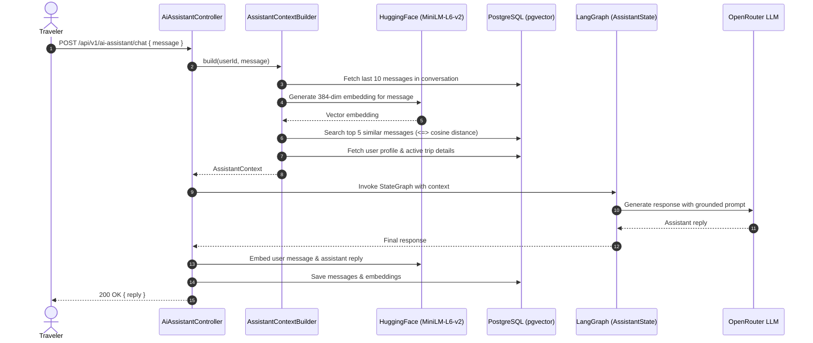
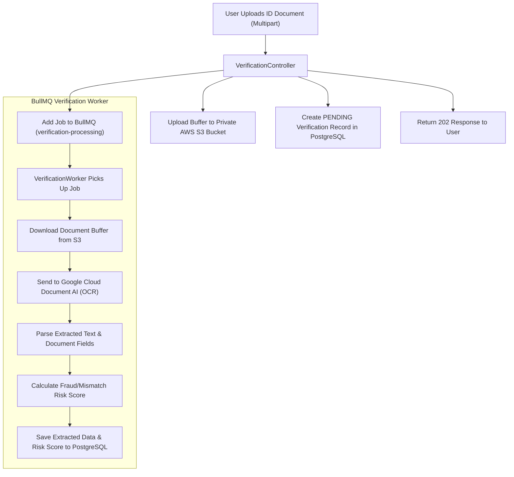
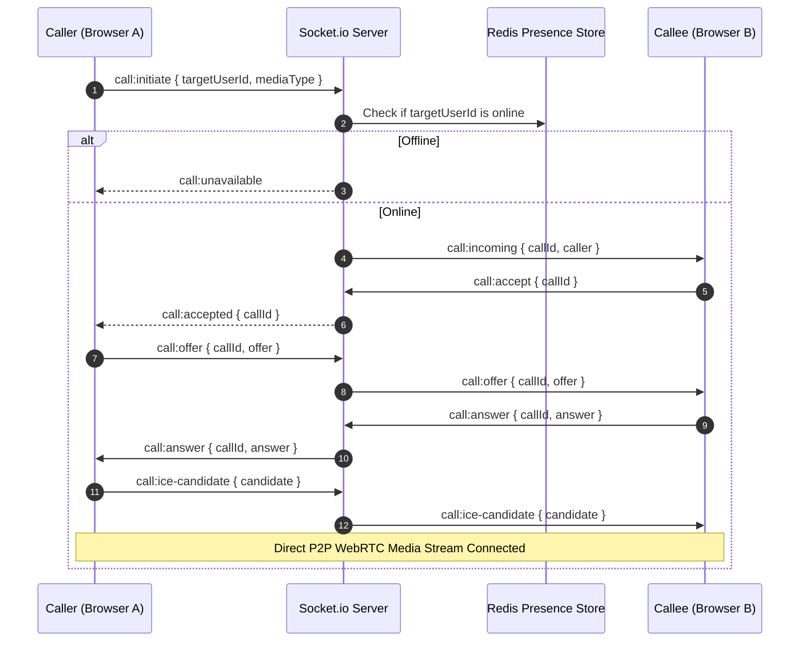
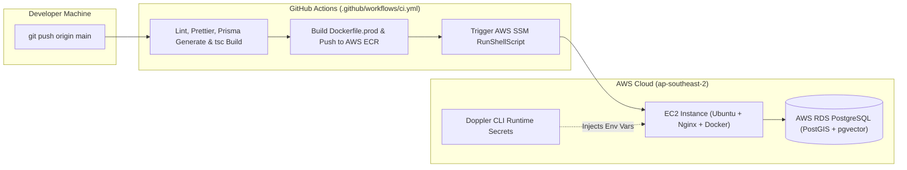

# Voymate Server

### Modular Backend for Solo Traveler Matchmaking, Real-Time Communication & Community Trips

[](https://www.typescriptlang.org/)
[](https://nodejs.org/)
[](https://expressjs.com/)
[](https://www.postgresql.org/)
[](https://www.prisma.io/)
[](https://redis.io/)
[](https://www.docker.com/)
[](https://github.com/features/actions)
[](https://www.doppler.com/)
[](https://aws.amazon.com/)

---

## Overview

**Voymate Server** is the backend API and real-time server for Voymate, a platform where solo travelers can match with compatible trip companions based on overlapping travel plans, find nearby travelers on a map, chat and video call in real time, and book verified community trips.

The backend is structured as a **Modular Monolith** following **Clean Architecture** and **Domain-Driven Design (DDD)** principles, using **TSyringe** for dependency injection so business logic in use cases stays decoupled from Express controllers, Prisma repositories, and third-party SDKs.

### What Was Built

- **Clean Architecture & Dependency Injection**: Divided into `domain`, `application`, `infrastructure`, and `presentation` layers. Controllers depend on use-case interfaces, and use cases depend on repository/service interfaces injected via `TSyringe`.
- **Geospatial Traveler Discovery (`PostGIS`)**: Uses `geography(Point, 4326)` columns with `ST_DWithin` and `ST_Distance` queries to find active travelers within a configurable kilometer radius, combined with a weighted compatibility scoring engine for trip matching.
- **RAG Travel Assistant (`LangGraph` + `pgvector` + Local Embeddings)**: Generates 384-dimensional vector embeddings locally on CPU using `@huggingface/transformers` (`Xenova/all-MiniLM-L6-v2`), retrieves relevant past messages from PostgreSQL via `pgvector` cosine distance (`<=>`), and combines them with the user's active trip details inside a `LangGraph` workflow.
- **Background ID Verification (`BullMQ` + `Google Document AI`)**: Offloads government ID OCR extraction and rule-based risk scoring to a Redis-backed `BullMQ` worker queue so document uploads return immediately without blocking HTTP requests.
- **Real-Time Chat & WebRTC Signaling (`Socket.io`)**: Handles 1-on-1 messaging, read receipts, multi-tab online presence tracking in Redis, and WebRTC offer/answer/ICE signaling for peer-to-peer audio and video calls.
- **3-Portal Role-Based Authentication**: Separate authentication flows and JWT session handling for **Travelers**, **Community Organizers**, and **Admins** (`SUPER_ADMIN`, `MODERATOR`, `ANALYST`), with hashed refresh token storage and rotation in Redis.
- **Community Trip Booking & Payments (`Razorpay`)**: Supports both free and paid community trips with capacity checks, Razorpay order creation, HMAC-SHA256 payment signature verification, and booking pass generation.
- **Automated AWS Deployment (`Docker`, `Doppler`, `GitHub Actions`, `AWS SSM`)**: Multi-stage Docker build pushed to Amazon ECR and deployed to EC2 (with AWS RDS and S3) via AWS Systems Manager (SSM) with runtime secret injection from Doppler.

---

## System Architecture

Dependencies point inward toward the domain and application layers:

```
[Presentation Layer]  -->  [Application Layer]  -->  [Domain Layer]
  (Controllers, Routes,      (Use Cases, DTOs,         (Entities, Enums,
   Socket Handlers, Zod)      Repository/Service        Domain Errors,
                              Interfaces)               Matching Service)
         |                           ^
         |                           |
         +------------------- [Infrastructure Layer]
                              (Prisma Repositories, Redis,
                               BullMQ, S3, LangGraph, Razorpay)
```



---

## Key Features & Implementation Details

### 1. Proximity Search & Trip Compatibility Engine (`PostGIS`)

- **Nearby Traveler Search**: Stores user coordinates as `geography(Point, 4326)` in PostgreSQL and uses `ST_DWithin` and `ST_Distance` to query active travelers within a given radius:
  ```sql
  SELECT u.id, u.full_name, l.current_city,
         ST_Distance(l.coordinates, ST_SetSRID(ST_MakePoint($1, $2), 4326)::geography) / 1000 AS distance_km
  FROM users u
  JOIN user_locations l ON u.id = l.user_id
  WHERE u.account_status = 'ACTIVE'
    AND u.id != $3
    AND ST_DWithin(l.coordinates, ST_SetSRID(ST_MakePoint($1, $2), 4326)::geography, $4)
  ORDER BY distance_km ASC;
  ```
- **Trip Match Scoring**: The domain `MatchingEngineService` computes compatibility scores between travelers' upcoming trips based on destination match, overlapping travel dates, budget compatibility, travel style, interests, and age/gender preferences.

---

### 2. AI Travel Assistant with RAG (`LangGraph` + `pgvector`)

Instead of sending the entire chat history on every prompt, the assistant builds a focused context before calling the LLM:



- **Local CPU Embeddings**: Uses `@huggingface/transformers` (`Xenova/all-MiniLM-L6-v2`) inside the Node.js process to generate 384-dimensional embeddings without paying for external embedding APIs.
- **Vector Search**: Queries `assistant_message_embeddings` using `pgvector`'s cosine distance operator (`<=>`) scoped to the user's `conversation_id`.

---

### 3. Asynchronous ID Verification (`BullMQ` + `Google Cloud Document AI`)

Document OCR takes several seconds per upload. To keep the API responsive, verification processing is handled in the background via BullMQ:



- **Queue Configuration**: Configured in `verification.queue.ts` with 3 retry attempts and 5-second exponential backoff.
- **Private S3 Storage**: Uploaded ID documents are stored in a private S3 bucket. When an admin reviews a verification request in the dashboard, the backend generates a temporary presigned `GET` URL (`expiresIn: 3600` seconds) via `@aws-sdk/s3-request-presigner`.

---

### 4. Real-Time Chat & WebRTC Call Signaling (`Socket.io`)



- **Multi-Tab Presence in Redis**: Tracks active socket IDs per user in Redis sets so opening multiple browser tabs doesn't mark a user offline when closing a single tab.
- **Call Authorization**: Validates that both users belong to the active call record before relaying WebRTC SDP offers, answers, and ICE candidates.

---

### 5. Community Trips & Razorpay Checkout

- **Organizer Portal**: Verified community organizers can publish free or paid group trips with itineraries, inclusions/exclusions, capacity limits, and cover galleries.
- **Payment Verification**:
  1. `CreateRazorpayOrderUseCase` creates an order via the Razorpay SDK.
  2. `VerifyRazorpayBookingUseCase` verifies the `razorpay_signature` using `crypto.createHmac('sha256', keySecret)` before confirming the booking and incrementing the trip's participant count.

---

## CI/CD, Docker & AWS Deployment



1. **CI Checks (`build-and-check`)**:
   - Validates branch names and Conventional Commit messages on pull requests.
   - Runs `npm ci`, `npx prisma generate`, `npm run format:check`, `npm run lint`, `npx tsc --noEmit`, and `npm run build`.
2. **Docker Build & ECR Push (`build-and-push`)**:
   - Authenticates with AWS using IAM credentials stored in GitHub Secrets.
   - Builds the multi-stage production image (`Dockerfile.prod`) and pushes `:latest` and `:${{ github.sha }}` tags to **Amazon ECR**.
3. **Zero-SSH Deployment via AWS SSM (`deploy`)**:
   - Uses `aws ssm send-command` to execute `/home/ubuntu/deploy.sh` on the EC2 instance without needing SSH port 22 open to GitHub runners.
   - The deploy script stops old containers, prunes unused Docker images, pulls the new image from ECR, runs `npx prisma migrate deploy` against **AWS RDS**, and starts the containers with **Doppler** injecting production environment variables (`CMD ["doppler", "run", "--", "npm", "start"]`).

---

## Project Structure

```
Server/
├── .github/workflows/
│   └── ci.yml                     # GitHub Actions CI/CD pipeline
├── postgres/
│   ├── Dockerfile                 # Local PostgreSQL image with PostGIS + pgvector
│   └── init-extensions.sql        # Enables uuid-ossp, postgis, and vector extensions
├── src/
│   ├── application/               # Use cases, DTOs, and repository/service interfaces
│   ├── config/                    # Env, DB, Redis, S3, Razorpay, and Twilio configs
│   ├── domain/                    # Entities, enums, domain errors, and matching service
│   ├── infrastructure/            # Prisma repos, BullMQ jobs, LangGraph AI, Socket.io, DI
│   ├── presentation/              # Express controllers, routes, middlewares, Zod schemas
│   ├── shared/                    # Response helpers, constants, and utilities
│   └── server.ts                  # Application entry point
├── Dockerfile                     # Local development Dockerfile
├── Dockerfile.prod                # Multi-stage production Dockerfile with Doppler CLI
├── docker-compose.yml             # Local dev stack (API + Postgres + Redis)
└── docker-compose.prod.yml        # Production compose file (API + Redis)
```

---

## Tech Stack

| Category                 | Technology                                                       | Usage                                                        |
| :----------------------- | :--------------------------------------------------------------- | :----------------------------------------------------------- |
| **Runtime & Language**   | Node.js 22, TypeScript 5                                         | Backend runtime and strict static typing                     |
| **Framework**            | Express 5                                                        | REST API routing and middleware                              |
| **Dependency Injection** | TSyringe                                                         | IoC container for Clean Architecture decoupling              |
| **Database & ORM**       | PostgreSQL, Prisma 7                                             | Relational data persistence and migrations                   |
| **Spatial & Vector**     | PostGIS, `pgvector`                                              | Proximity radius queries and vector similarity search        |
| **Cache & Queues**       | Redis, BullMQ                                                    | Refresh token sessions, socket presence, and OCR job queue   |
| **Real-Time**            | Socket.io                                                        | 1-on-1 chat and WebRTC call signaling                        |
| **AI & Embeddings**      | `@langchain/langgraph`, `@huggingface/transformers`              | Conversational travel assistant and local CPU embeddings     |
| **Document OCR**         | Google Cloud Document AI                                         | Identity and organizer document text extraction              |
| **Storage**              | AWS S3 (`@aws-sdk/client-s3`)                                    | Private object storage with presigned GET URLs               |
| **Payments**             | Razorpay                                                         | Community trip checkout and signature verification           |
| **Secrets & DevOps**     | Docker, Doppler, GitHub Actions, AWS (EC2, ECR, RDS, SSM), Nginx | Containerization, secret injection, and automated deployment |
| **Logging & Metrics**    | Winston, Morgan, `prom-client`                                   | Rotating log files and Prometheus `/metrics` endpoint        |

---

## Local Development Setup

### 1. Prerequisites

- Node.js `v22.x`
- Docker & Docker Compose

### 2. Run with Docker Compose

```bash
git clone https://github.com/Nasif284/Voymate-server.git
cd Voymate-server

# Start Postgres (PostGIS + pgvector) and Redis
docker compose up -d postgres redis

# Install dependencies and generate Prisma client
npm install
npm run db:generate

# Run migrations and seed initial roles & countries
npm run db:migrate
npm run db:seed

# Start development server
npm run dev
```

### 3. Useful Scripts

```bash
npm run dev              # Run in development watch mode (tsx)
npm run build            # Compile TypeScript to dist/
npm run start            # Start compiled production build
npm run lint             # Run ESLint
npm run format:check     # Check formatting with Prettier
npm run db:migrate       # Run Prisma migrations in dev
npm run db:migrate:deploy # Apply pending migrations in production
```
